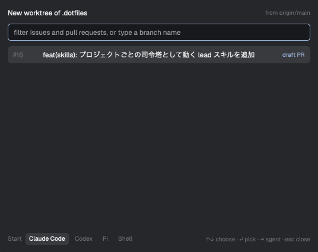

# Issue worktree

A dialog that makes a git worktree from a GitHub issue or pull request and starts an agent in it, and a Spaces sidebar that shows a space's linked issue and pull request when hovered.

**What you see:** the dialog (600×480, `popover` background, 16px padding) has a title `New worktree of <repo>` with `from <remote default branch>` at the right, a text input, a scrolling list of rows (32px: `#<number>` in dim, the title, then `issue`, `PR` or `draft PR`), and a footer with `Start` and one chip per installed agent plus `Shell`, and the key hints at the right. In the sidebar, a card (340px wide, `popover` background, 1px border) opens under a hovered space: the space's name, its branch, then `ISSUE` and `PULL REQUEST` rows with a state dot (open `ansi2`, merged `ansi5`, closed `ansi1`, draft dim), the title and `#<number>`.

**How it behaves:** typing filters the list; ↑↓ move, Enter picks, Tab cycles the agent, Esc closes. Picking an issue swaps the list for the branch name, prefilled `fix/<n>-<words>` for a bug (a `bug` label or a `[BUG]` title) and `feat/<n>-<words>` otherwise, the words being the title's ASCII ones; Enter creates, Esc goes back. Picking a pull request creates at once on its branch. Text that matches nothing is a plain branch name. Creating runs `git worktree add` into `~/.herdr/worktrees/<repo>/<branch, slashes as dashes>`: an issue's new branch starts from the remote's default branch, fetched first, with `--no-track`; a pull request's branch is fetched from `origin`; a branch that exists is checked out as it is. For an issue, `git config branch.<name>.issue <number>` is written. Then `space.new {folder, argv, task}` opens the checkout with the chosen agent, whose first message for an issue is `Work on <url>`. The sidebar card shows only for a space that is a linked worktree or whose branch has `branch.<name>.issue`; hovering asks `gh issue view` and `gh pr list --head <branch> --state all`, at most once per five minutes per branch; clicking a row opens its URL.

**Built from:** `issue-worktree`: `mod.json` `{ "place": "none", "overlay": { "kind": "dialog", "width": 600, "height": 480 } }`, opened with `mod.open`; `InputState` + `Input`, `Scrollbar`, `exec` (`git`, `gh issue list`, `gh pr list`), `knownAgents`, `focused().cwd` for the repository, `run("space.new")`. `spaces-issues`: a copy of Herdr's shipped `spaces` mod (0.1.15) with `HoverCard` and `Link` imported from `gpui-base`; `check()` also reads `branch.<head>.issue`; `link(g, cx)` and `card(w, g, t)` methods; the row wrapped in `HoverCard.new(id).open_delay(400).trigger(row).content(card)` and given an `on_hover` that starts `link`.

**Watch out:** `HoverCard` never reports that it opened, so the GitHub lookup starts from the row's own `on_hover`. The card opens under the row; `.anchor("left_center")` did not move it beside the row. Herdr's layouts are read-only: clone the layout and set the Spaces block's `content.mod` to `spaces-issues`; the copy does not get Herdr's later fixes to `spaces`. Pull requests from forks are left out of the list, and the pull request's remote is taken to be `origin`. The checkout root is a constant at the top of `issue-worktree/main.js`.

**Done when:** `herdr-app check` passes for both mods; `herdr-app do mod.open '{"name":"issue-worktree"}'` in a GitHub repository lists its open issues and pull requests; creating from an issue leaves a new space in `~/.herdr/worktrees/<repo>/<branch>` with `git config branch.<branch>.issue` set; hovering that space in the sidebar shows the issue's title and number.
